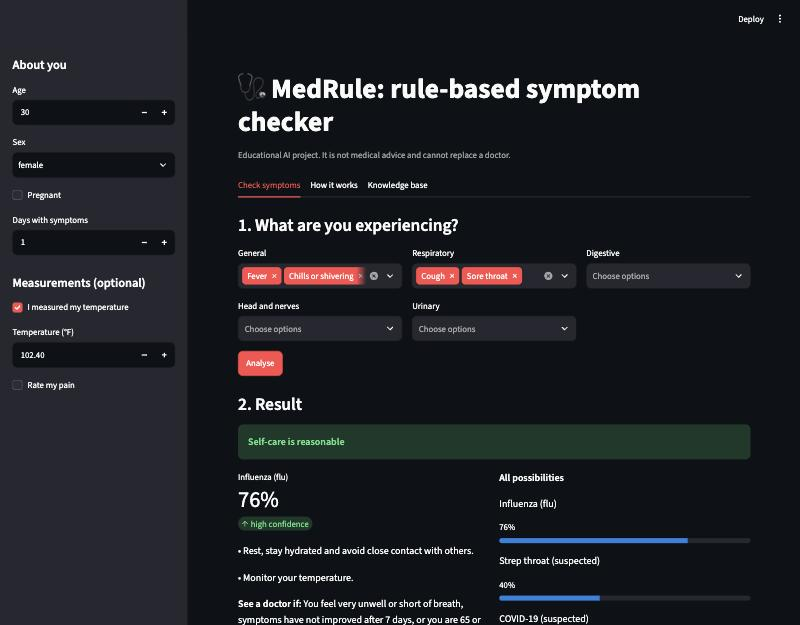
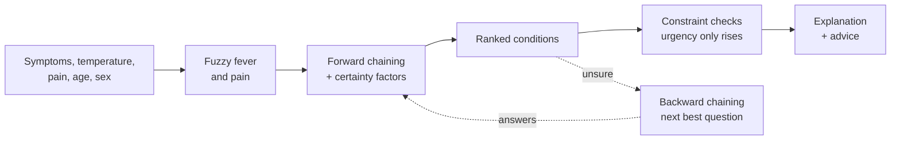
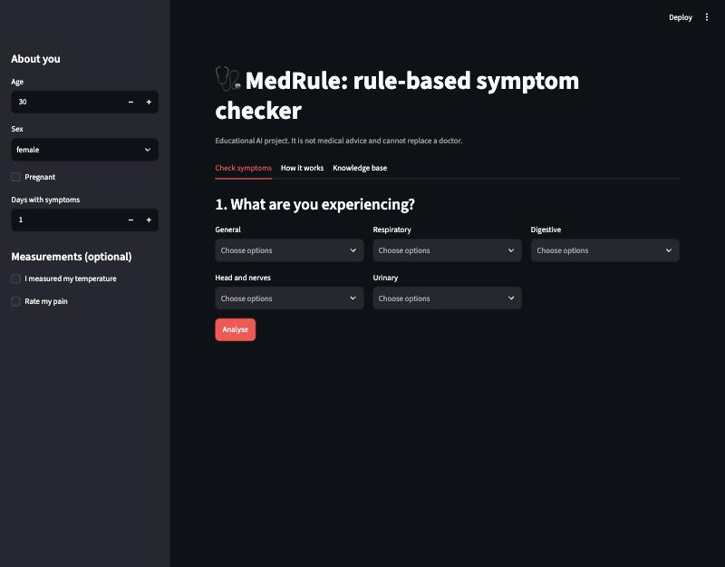
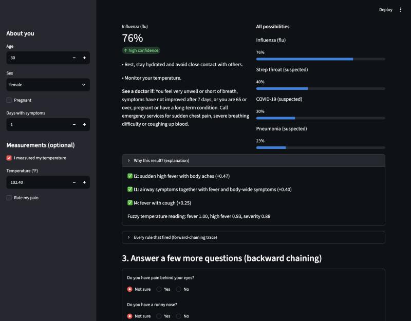
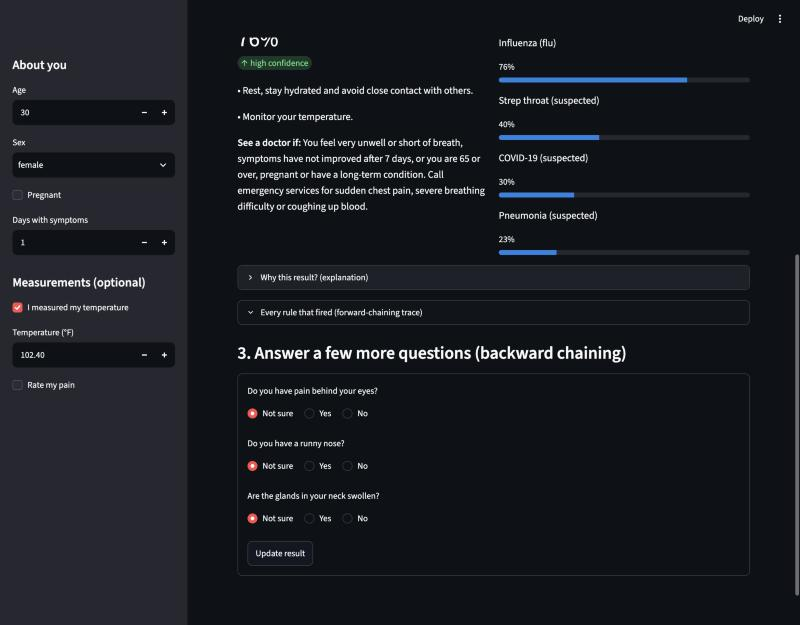
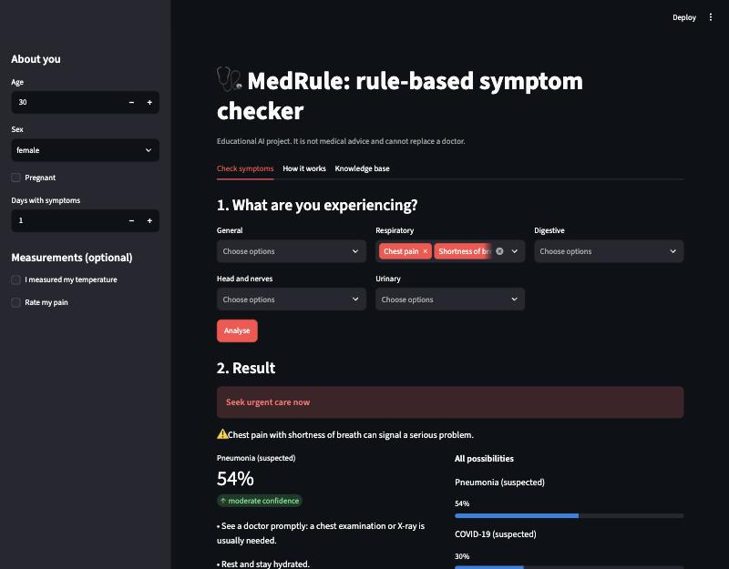

<div align="center">

# 🩺 MedRule

### A rule-based symptom checker that explains every answer

Forward and backward chaining · MYCIN certainty factors · fuzzy logic · safety constraints




</div>

> **Educational project. Not medical advice.** The rules were written for a university course and checked
> against NHS condition pages, but they have **not** been reviewed by a clinician. Never use this tool to
> decide on real treatment.

---

## Contents

[Why MedRule](#why-medrule) · [Features](#features) · [How it works](#how-it-works) · [Quick start](#quick-start) · [Example](#example) · [Knowledge base](#knowledge-base) · [Results](#results) · [Project structure](#project-structure) · [Screenshots](#screenshots) · [Team](#team) · [References](#references) · [Acknowledgements](#acknowledgements) · [License](#license)

---

## Why MedRule

Symptom searches give vague or frightening answers, and machine-learning tools usually cannot say *why*
they reached a conclusion. MedRule takes the classical expert-system route: medical knowledge is written as
explicit IF-THEN rules with certainty values, so every answer can be traced, questioned and corrected.

- **Explainable.** Each score lists the exact rules that produced it.
- **No training data.** Knowledge lives in one readable JSON file.
- **Safety first.** Red flags raise the urgency level, and nothing can lower it.

## Features

| | |
|---|---|
| 🧠 **Forward chaining** | Fires every matching rule: symptoms → syndromes → disease hypotheses |
| 📊 **Certainty factors** | MYCIN-style scores in [−1, 1] merge supporting *and* opposing evidence |
| 🌡️ **Fuzzy logic** | A temperature is partly "moderate" and partly "high" fever, so there is no cliff at 100.4 °F |
| ❓ **Backward chaining** | Tries to prove each hypothesis and asks the most useful follow-up questions |
| 🛡️ **Constraint checking** | Rejects impossible profiles; red flags, age, pregnancy and duration raise urgency |
| 🔍 **Rule-trace explanations** | Every result shows which rules fired and by how much |
| 💻 **Two interfaces** | Streamlit web app and a command-line tool with an interactive question loop |
| ✅ **Tested** | 53 automated tests, including headless UI tests and a regression check on accuracy |

## How it works



A worked example, using the flu case from the screenshot above (fever 1.00 and high fever 0.93 at 102.4 °F):

| Rule | Evidence | Contribution | Running confidence |
|---|---|---|---|
| I1 | airway + whole-body symptoms | +0.40 | 0.40 |
| I2 | high fever × body aches (0.50 × 0.93) | +0.47 | 0.68 |
| I4 | fever with cough | +0.25 | **0.76** |

Certainty factors combine as `cf1 + cf2 × (1 − cf1)` when both are positive, so
0.40 + 0.47 × 0.60 = 0.68, then 0.68 + 0.25 × 0.32 = 0.76. Opposing evidence uses the MYCIN mixed-sign formula.

### Why these algorithms

| Need | Chosen | Instead of |
|---|---|---|
| Symptoms → conclusions | Forward chaining | asking for a goal disease first |
| Uncertain, conflicting evidence | Certainty factors | a Bayesian network (needs priors we cannot source) |
| Graded readings | Fuzzy sets | hard temperature thresholds |
| What to ask next | Backward chaining + scoring | a fixed questionnaire |
| Safety | Separate constraint layer | mixing safety into rule weights |
| Trust | Rule-trace explanation | explanations added after the fact |

The full reasoning is in [`docs/REPORT.md`](docs/REPORT.md).

## Quick start

```bash
git clone https://github.com/rago12bit/aip.git
cd aip
python -m venv .venv && source .venv/bin/activate     # Windows: .venv\Scripts\activate
pip install -r requirements.txt
```

**Web app**

```bash
streamlit run app.py
```

Demo links that pre-fill a case: `http://localhost:8501/?demo=flu`, `?demo=migraine`, `?demo=redflag`.

**Command line**

```bash
python cli.py --list-symptoms                                   # every symptom id
python cli.py --symptoms fever cough body_aches --temp 102.4    # one-shot diagnosis
python cli.py --symptoms headache --interactive                 # asks follow-up questions
python cli.py --symptoms fever cough --trace                    # print every rule that fired
```

**Tests and experiment**

```bash
python -m pytest                          # 53 tests
python experiments/compare_methods.py     # accuracy against simpler methods
```

Requires Python 3.10 or newer.

## Example

```text
$ python cli.py --symptoms fever chills body_aches cough sore_throat --temp 102.4 --age 30 --sex female

Most likely: Influenza (flu)
Confidence: high (76%)
Why:
  + [I2] sudden high fever with body aches (+0.47)
  + [I1] airway symptoms together with fever and body-wide symptoms (+0.40)
  + [I4] fever with cough (+0.25)
Other possibilities:
  * Strep throat (suspected) (40%)
  * COVID-19 (suspected) (30%)
  * Pneumonia (suspected) (23%)

Urgency: Self-care is reasonable
  - Rest, stay hydrated and avoid close contact with others.
  - Monitor your temperature.
See a doctor if: You feel very unwell or short of breath, symptoms have not improved after 7 days, ...
```

## Knowledge base

`data/kb.json` is the whole medical model: **10 conditions, 31 symptoms, 53 rules**
(39 supporting, 9 opposing, 5 syndrome rules).

```text
IF   high_fever AND body_aches      →  THEN influenza            CF +0.50   (rule I2)
IF   fever                          →  THEN allergic_rhinitis    CF −0.60   (rule A4)
```

A negative value lets a symptom argue *against* a disease. The loader refuses rules that name an unknown
symptom or use a certainty value outside [−1, 1].

| Condition | Source used to check it |
|---|---|
| Common cold, influenza, COVID-19, hay fever, migraine, dengue, pneumonia | NHS condition pages |
| Strep throat | NHS sore-throat page and the Centor criteria (1981) |
| Gastroenteritis | NHS diarrhoea and vomiting page |
| Urinary tract infection | NHS UTI page |

NHS pages were accessed on 15 November 2026. The certainty values themselves are the team's own estimates,
and a few rules are our own heuristics; both are listed in the report.

## Results

`experiments/compare_methods.py` compares the full system with simpler variants on hand-written vignettes
(details in [`docs/EXPERIMENT.md`](docs/EXPERIMENT.md)).

| Method | General set, 40 cases | Targeted set, 10 cases |
|---|---|---|
| **Full system** | 95% | **100%** |
| Without negative-evidence rules | 95% | 90% |
| Hard fever thresholds instead of fuzzy | 95% | 90% |
| Symptom-overlap baseline | 95% | 80% |

**Honest reading:** on ordinary cases every method scores the same, so the extra machinery adds no
measurable accuracy there. The targeted cases were written to probe one feature each, so each gap is a single
case. What the design does add is a graded confidence, evidence that argues against a disease, and an
explanation for every score. The cases were written by the team, so this checks consistency, not clinical
accuracy.

## Project structure

```text
.
├── app.py                 Streamlit web app
├── cli.py                 command-line interface
├── expert_system.py       facade: runs the whole pipeline
├── knowledge_base.py      loads and validates data/kb.json
├── forward_chaining.py    rules → facts
├── backward_chaining.py   proof trees and follow-up questions
├── certainty.py           MYCIN certainty-factor maths
├── fuzzy.py               fuzzy temperature and pain sets
├── constraints.py         profile checks, red flags, urgency
├── explain.py             rule-trace explanations
├── data/kb.json           the knowledge base
├── experiments/           vignettes and the method comparison
├── tests/                 unit, scenario, experiment and UI tests
└── docs/                  report, experiment results, screenshots
```

## Screenshots

| | |
|---|---|
|  |  |
| Home: symptom groups and measurements | Result with confidence, advice and urgency |
|  |  |
| Which rules produced the result | Backward chaining picks the next questions |
|  | |
| Chest pain with breathlessness forces "Seek urgent care now" | |

## Limitations

- Only 10 conditions, and many illnesses share symptoms, so results are *possibilities*, not diagnoses.
- Certainty factors are not true probabilities and assume rules are roughly independent.
- Rule weights are hand-set; the test cases were written by the team; there has been no clinical review.
- Medical sources are UK (NHS) only, and the dengue page is written for travellers.

## Team

Course project for **Artificial Intelligence**, B.Tech Information Technology, 2026–27.

| Member | Role |
|---|---|
| Raghav Gupta | [role] |
| [Member 2] | [role] |
| [Member 3] | [role] |
| [Member 4] | [role] |
| [Member 5] | [role] |
| [Member 6] | [role] |

## References

1. Shortliffe, E. H., & Buchanan, B. G. (1975). A model of inexact reasoning in medicine. *Mathematical Biosciences, 23*(3–4), 351–379.
2. Zadeh, L. A. (1965). Fuzzy sets. *Information and Control, 8*(3), 338–353.
3. Miller, R. A., Pople, H. E., & Myers, J. D. (1982). Internist-1, an experimental computer-based diagnostic consultant for general internal medicine. *New England Journal of Medicine, 307*(8), 468–476.
4. Centor, R. M., et al. (1981). The diagnosis of strep throat in adults in the emergency room. *Medical Decision Making, 1*(3), 239–246.
5. Russell, S., & Norvig, P. (2021). *Artificial Intelligence: A Modern Approach* (4th ed.). Pearson.
6. NHS condition pages for the ten conditions, accessed 15 November 2026.

The complete list with links is in [`docs/REPORT.md`](docs/REPORT.md).

## Acknowledgements

The layered architecture (UI → facade → separate reasoning engines → knowledge base) follows
[anandd46/AI_Medical_Diagnosis_Expert_System](https://github.com/anandd46/AI_Medical_Diagnosis_Expert_System)
(MIT). MedRule's code was written from scratch and is much smaller: no database, no predicate-logic engine,
no extra search algorithms, and no treatment data. It adds negative-evidence rules, measured-temperature
override, urgency escalation, a question-ranking heuristic, a command-line interface, tests and a comparison
experiment.

## License

Released under the [MIT License](LICENSE).
