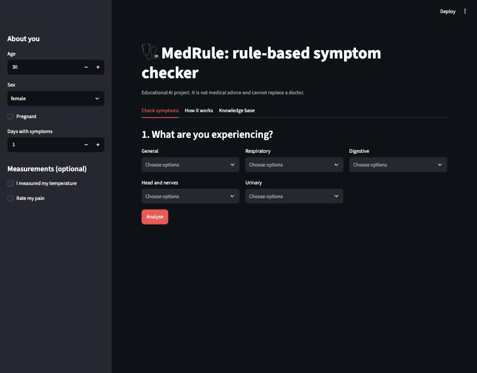
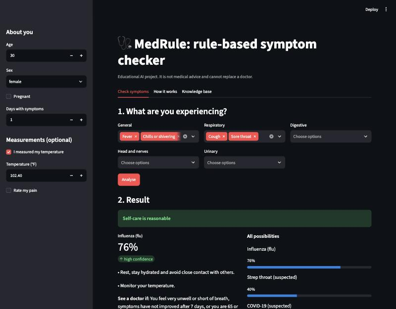
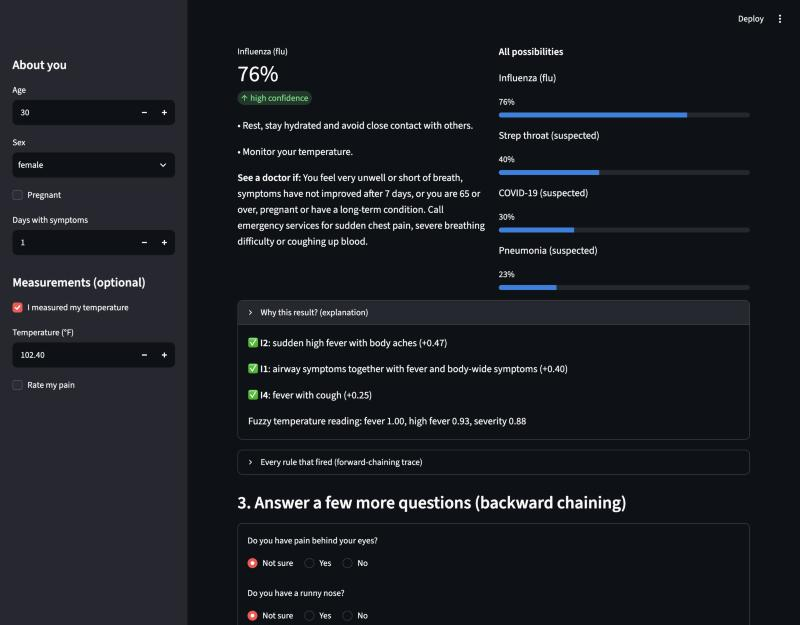
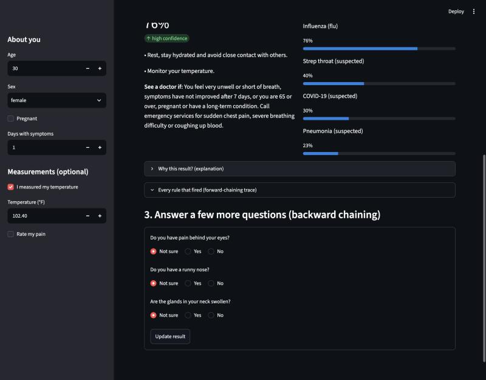
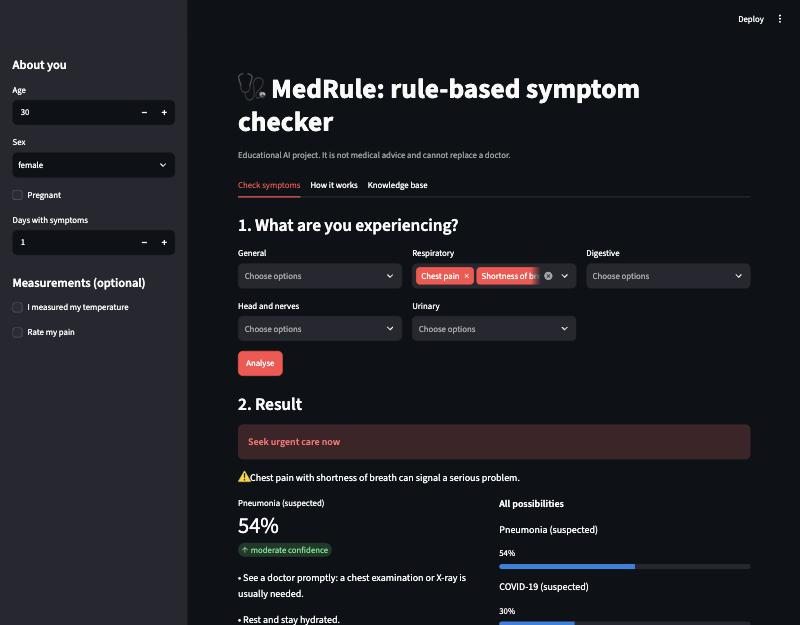

# MedRule: A Rule-Based Symptom Checker
### Project report

Course: [course name] | Team: [team name] | Date: [date]

Sections follow the marking scheme: Project Idea, Background, Algorithm Selection and Rationale,
Implementation, Teamwork, References.

---

## 1. Project Idea

**Problem.** Many people search the web for symptoms and get either frightening or vague answers with no
reasoning attached. Statistical diagnostic tools can be accurate but cannot say *why* they reached a
conclusion, which matters most in health care.

**Idea.** MedRule is a small expert system that suggests which common condition best fits a set of
symptoms, says how sure it is, explains the rules behind that answer, and tells the user how urgently to
seek care. Everything is symbolic: facts, IF-THEN rules and certainty values that can be read and edited.

**What it does**

1. The user selects symptoms and, optionally, a measured temperature and pain rating plus basic details
   (age, sex, pregnancy, how long the symptoms have lasted).
2. The system ranks 10 common conditions with a confidence value and explains the ranking.
3. A safety layer raises the urgency for red-flag combinations, very young or old patients, pregnancy,
   and long or dangerous fever.
4. If the answer is uncertain, the system asks the most useful follow-up questions.

**Scope.** Educational prototype: 10 conditions, 31 symptoms, 53 rules. It is *not* a medical device and
gives general advice only (no drug names or doses).

**What is new compared with the reference project** (section 4.6): negative-evidence rules, measured
readings that override tick-boxes, urgency that can only rise, and a question-ranking heuristic built on
backward chaining.

---

## 2. Background and Related Work

**Expert systems.** In the 1970s and 80s, *expert systems* captured a specialist's knowledge as rules and
applied it with an inference engine. Medicine was the leading application: **MYCIN** (Shortliffe, 1976)
recommended antibiotics for blood infections from several hundred rules, and **INTERNIST-1** (Miller et al.,
1982) supported diagnosis in internal medicine. MYCIN's lasting contribution was handling uncertain evidence
with *certainty factors* (Shortliffe & Buchanan, 1975) and explaining its reasoning to the doctor, the two
properties this project keeps.

**Why symbolic AI today.** Machine-learning classifiers need labelled patient data, which we do not have,
and are hard to audit. A rule base needs no training data, can be reviewed line by line by a clinician, and
has a built-in explanation. That trade-off is the motivation for the project.

**Key ideas used**

- *Forward chaining* works from known facts to conclusions; *backward chaining* works from a goal to the
  facts needed to prove it (Russell & Norvig, 2021, ch. 9).
- *Certainty factors* attach a number in [-1, 1] to a belief and merge evidence from several rules.
- *Fuzzy sets* (Zadeh, 1965) give degrees of membership, so 101 °F is "a bit" and 104 °F is "fully" a fever.
- *Constraint satisfaction* checks that values are consistent with each other (Russell & Norvig, 2021, ch. 6).

**Medical sources for the rules.** The condition descriptions, red flags and "see a doctor if" advice were
checked against NHS (UK) condition pages for all ten conditions (references 11 to 20, accessed 15 November
2026). Strep-throat reasoning follows the Centor criteria (Centor et al., 1981): fever, swollen neck glands
and *absence* of cough raise the likelihood. A few rules are the team's own heuristics rather than published
guidance: cold-like symptoms counting against dengue (D5), fever with digestive symptoms counting weakly for
gastroenteritis (G3), cough with runny nose counting against strep (T5), and the rule weights themselves.

**Related project.** `anandd46/AI_Medical_Diagnosis_Expert_System` (MIT licence) is a larger symbolic diagnosis
system with SQLite storage, a first-order logic engine, extra search algorithms and a PDF export. MedRule
keeps its layered architecture but is rewritten from scratch and much simpler.

---

## 3. Algorithm Selection and Rationale

| Need | Algorithm chosen | Why it fits | Alternatives considered |
|---|---|---|---|
| Move from symptoms to conclusions | **Forward chaining** | The input is a set of known facts and we want *every* consequence, so data-driven reasoning is natural. Each rule fires once, which prevents double counting. | Backward chaining alone would need a goal per disease and many questions up front. |
| Combine uncertain, partly conflicting evidence | **Certainty factors (MYCIN)** | Needs no probability tables or training data. Supports positive *and* negative evidence. Combination is commutative and bounded in [-1, 1]. | A Bayesian network needs priors and conditional probabilities we cannot source. A decision tree hides conflicting evidence. |
| Graded readings (fever, pain) | **Fuzzy membership + weighted-average defuzzification** | A reading belongs partly to several classes, avoiding a cliff at 100.4 °F. The output plugs straight into the certainty factors. | Hard thresholds (simple, but abrupt). A full Mamdani system (heavier, no clear gain here). |
| Decide what to ask next | **Backward chaining + question scoring** | Proving a hypothesis shows which unanswered symptoms block it. Ranking them by hypothesis CF and rule weight asks what matters most. | A fixed questionnaire (long, ignores the case). Information gain (needs probabilities). |
| Keep results safe | **Constraint checking** | Hard constraints reject impossible profiles. Safety constraints are separate from the symptom logic and only raise urgency, so a strong match can never hide a red flag. | Folding safety into rule CFs (would let evidence offset danger). |
| Make results trustworthy | **Rule-trace explanation** | Every conclusion records the firing rules, so the output is auditable. | Post-hoc explanations (not faithful to the real reasoning). |

### Worked example

Symptoms: fever, chills, body aches, cough, sore throat. Temperature 102.4 °F, age 30 (this is the `?demo=flu` link).

1. Fuzzy: at 102.4 °F, fever = 1.00 and high fever = 0.93 (the "high" set rises from 101 °F to full at 102.5 °F).
2. Forward chaining derives `syndrome:respiratory` and `syndrome:systemic`.
3. Influenza rules fire: I1 = +0.40, I2 = 0.50 × 0.93 = +0.47, I4 = +0.25.
4. Certainty factors combine: 0.40 + 0.47 × (1 − 0.40) = 0.682, then 0.682 + 0.25 × (1 − 0.682) = **0.76**.
5. Competing hypotheses: strep throat 40 %, COVID-19 30 %, pneumonia 23 %. Common cold drops out because the high fever fires C5 (−0.47).
6. Constraints: no red flag, adult, fever under 3 days, so urgency stays "self-care".

### Does the choice pay off? An experiment

`experiments/compare_methods.py` compares the full system with three simpler variants on hand-written
vignettes (details and per-case failures in [EXPERIMENT.md](EXPERIMENT.md)).

| Method | General set, 40 cases (top-1) | Targeted set, 10 cases (top-1) |
|---|---|---|
| Full system | 38/40 (95 %) | 10/10 |
| Without negative-evidence rules | 38/40 (95 %) | 9/10 |
| Hard fever thresholds instead of fuzzy | 38/40 (95 %) | 9/10 |
| Overlap baseline (share of symptoms matched) | 38/40 (95 %) | 8/10 |

**Honest reading.** On ordinary presentations every method does equally well, so the added machinery buys *no
measurable accuracy* there. The targeted cases were written on purpose to probe negative evidence and borderline
fever, so they are not a fair sample, and each difference is a single case. What the certainty-factor design
does provide, and the baseline cannot, is a graded confidence, a way to say "this symptom argues *against* that
disease", and an explanation of every score. The vignettes were written by the authors after the knowledge base,
so this is a consistency check, not a clinical evaluation.

One finding changed the code: while writing the targeted cases we saw that the "high fever" fuzzy set started at
102 °F even though the knowledge base labels 102 °F as high fever. The set now starts at 101 °F. Inspecting the
red-flag demo also showed a cold ranked first for chest pain with breathlessness; rules C6, C7 and P5 were added.

### Complexity

With R rules and c conditions per rule, one forward-chaining pass is O(R·c), and each rule fires at most once,
so the worst case is O(R²·c). With R = 53 a full diagnosis takes about 0.03 ms on a laptop. Backward chaining
with memoisation visits each goal once.

---

## 4. Implementation

### 4.1 Architecture

```
UI (app.py, cli.py)
        │
expert_system.py  ── facade: validate → fuzzy → forward chain → rank → constraints → explain
   │        │          │            │
fuzzy.py  forward_chaining.py  constraints.py  explain.py
              │  ▲
        certainty.py     backward_chaining.py  (follow-up questions, proof trees)
              └──────────────┬───────────────┘
                     knowledge_base.py ← data/kb.json
```

### 4.2 Modules

| Module | Responsibility |
|---|---|
| `knowledge_base.py` | load JSON, build `Rule` objects, validate (unknown symptoms, CF range, diseases without rules) |
| `forward_chaining.py` | fire rules to a fixed point, record every firing |
| `backward_chaining.py` | `prove()` builds a proof tree; `suggest_questions()` ranks open questions |
| `certainty.py` | MYCIN combination, confidence labels, ranking |
| `fuzzy.py` | trapezoid sets for temperature and pain, defuzzification |
| `constraints.py` | profile constraints, red-flag and risk alerts, urgency escalation |
| `explain.py` | supporting and opposing rules, alternatives |
| `expert_system.py` | orchestrates the pipeline |
| `app.py`, `cli.py` | Streamlit and command-line front ends |

### 4.3 Knowledge base

`data/kb.json` holds 31 symptoms in 5 groups, 10 conditions and 53 rules: 5 *syndrome* rules (for example any
upper-airway symptom → `syndrome:respiratory`), 39 positive and 9 negative disease rules. Example:
`I2: IF high_fever AND body_aches THEN disease:influenza CF 0.50`. A rule may use `if` (all must hold) and
`if_any` (at least one). `not:<symptom>` means the user said they do *not* have it. The loader refuses a rule
that names an unknown symptom or has a CF outside [-1, 1].

> The medical content was checked against NHS pages (section 2) but **has not been reviewed by a clinician**.
> It is an educational model, not clinical guidance.

### 4.4 Testing

53 automated tests (`python -m pytest`):

- certainty-factor maths (combination, symmetry, bounds),
- fuzzy shape, monotonicity and the 100.4 °F fever line,
- knowledge-base validation (bad rules are rejected),
- forward chaining (derived syndromes, single firing, negative evidence, fuzzy scaling),
- 10 end-to-end scenarios, one per condition,
- constraints (profile errors, red flags, age and pregnancy, dangerous temperature, urgency never decreases),
- backward chaining (proved / failed / unknown, proof CF equals forward-chaining CF, follow-up questions),
- the experiment (accuracy on the general set must not regress),
- the Streamlit app, driven headlessly with Streamlit's `AppTest`, including a demo link.

Result at submission time: **53 passed**.

### 4.5 Screenshots

Generated from the running app (`streamlit run app.py`, then the `?demo=flu` and `?demo=redflag` links).

| | |
|---|---|
|  |  |
| *Home: symptom groups and measurements* | *Result with confidence, advice and urgency* |
|  |  |
| *Which rules produced the result, and the fuzzy reading* | *Backward chaining picks the next questions* |
|  | |
| *Chest pain with breathlessness forces "seek urgent care now"* | |

### 4.6 Differences from the reference project

| Kept | Removed | Added |
|---|---|---|
| layered design: UI → facade → engines → knowledge base | SQLite database, patient records, visit history | negative-evidence rules |
| forward and backward chaining | predicate-logic and unification engine | measured readings override tick-boxes |
| certainty factors | scikit-fuzzy, networkx, matplotlib, reportlab | urgency escalation (red flags, age, pregnancy, duration) |
| fuzzy severity | best-first, hill climbing, generate-and-test, problem reduction | question-ranking heuristic |
| constraint checking, explanations | medicine database and treatments | command-line interface, rule-trace table, demo links, automated tests, comparison experiment |

### 4.7 Limitations and future work

- Only 10 conditions; many illnesses share symptoms, so results are *possibilities*, not diagnoses.
- Certainty factors are not probabilities and assume the rules are roughly independent.
- Rule CFs are hand-set; with real data they could be calibrated or learned.
- The comparison used the authors' own vignettes, not patient records; the general-set accuracy is not
  evidence of clinical accuracy. A fair test needs cases written by clinicians.
- Medical sources are UK (NHS) only; the dengue page is written for travellers, so dengue weights are the least certain.
- Future work: more conditions, clinician review, other languages, and a Bayesian version for comparison.

---

## 5. Teamwork

Fill in with the real division of work. One possible split, by module:

| Member | Role | Contribution |
|---|---|---|
| [Name 1] | Knowledge engineering | `data/kb.json`, source checking, `knowledge_base.py` |
| [Name 2] | Inference | `forward_chaining.py`, `certainty.py`, tests for both |
| [Name 3] | Questioning and safety | `backward_chaining.py`, `constraints.py`, `fuzzy.py` |
| [Name 4] | Interface and report | `app.py`, `cli.py`, `explain.py`, experiment, this report |

Add: how often you met, how you reviewed each other's code (pull requests), and how disagreements about rule
weights were resolved. Evidence such as the git history and issues can be attached.

---

## 6. References

1. Shortliffe, E. H., & Buchanan, B. G. (1975). A model of inexact reasoning in medicine. *Mathematical Biosciences, 23*(3–4), 351–379. https://doi.org/10.1016/0025-5564(75)90047-4
2. Shortliffe, E. H. (1976). *Computer-Based Medical Consultations: MYCIN*. American Elsevier.
3. Buchanan, B. G., & Shortliffe, E. H. (Eds.). (1984). *Rule-Based Expert Systems: The MYCIN Experiments of the Stanford Heuristic Programming Project*. Addison-Wesley.
4. Miller, R. A., Pople, H. E., & Myers, J. D. (1982). Internist-1, an experimental computer-based diagnostic consultant for general internal medicine. *New England Journal of Medicine, 307*(8), 468–476. https://doi.org/10.1056/NEJM198208193070803
5. Zadeh, L. A. (1965). Fuzzy sets. *Information and Control, 8*(3), 338–353. https://doi.org/10.1016/S0019-9958(65)90241-X
6. Russell, S., & Norvig, P. (2021). *Artificial Intelligence: A Modern Approach* (4th ed.). Pearson.
7. Jackson, P. (1998). *Introduction to Expert Systems* (3rd ed.). Addison-Wesley.
8. Centor, R. M., Witherspoon, J. M., Dalton, H. P., Brody, C. E., & Link, K. (1981). The diagnosis of strep throat in adults in the emergency room. *Medical Decision Making, 1*(3), 239–246. https://doi.org/10.1177/0272989X8100100304
9. anandd46. *AI_Medical_Diagnosis_Expert_System* [Source code, MIT licence]. GitHub. https://github.com/anandd46/AI_Medical_Diagnosis_Expert_System
10. Streamlit. *Streamlit documentation*. https://docs.streamlit.io

NHS condition pages used to check the knowledge base (all accessed 15 November 2026):

11. NHS. *Common cold*. https://www.nhs.uk/conditions/common-cold/
12. NHS. *Flu*. https://www.nhs.uk/conditions/flu/
13. NHS. *COVID-19 symptoms and what to do*. https://www.nhs.uk/conditions/covid-19/covid-19-symptoms-and-what-to-do/
14. NHS. *Hay fever*. https://www.nhs.uk/conditions/hay-fever/
15. NHS. *Sore throat*. https://www.nhs.uk/conditions/sore-throat/
16. NHS. *Diarrhoea (and vomiting)*. https://www.nhs.uk/conditions/diarrhoea/
17. NHS. *Migraine*. https://www.nhs.uk/conditions/migraine/
18. NHS. *Dengue*. https://www.nhs.uk/conditions/dengue/
19. NHS. *Urinary tract infections (UTIs)*. https://www.nhs.uk/conditions/urinary-tract-infections-utis/
20. NHS. *Pneumonia*. https://www.nhs.uk/conditions/pneumonia/
